


&nbsp;
&nbsp;
&nbsp;
&nbsp;

 






  <a href="https://kimjihoon.me/#projects"></a>
  <a href="https://kimjihoon.me/#projects"></a>

  <a href="https://kimjihoon.me/#projects"></a>
  <a href="https://github.com/resourceful-hooni/Yonsei-HCI-LAB-Intern-rPPG-BP-Estimation"></a>



<picture>
  <source media="(prefers-color-scheme: dark)" srcset="https://raw.githubusercontent.com/resourceful-hooni/resourceful-hooni/output/github-snake-dark.svg">
  <source media="(prefers-color-scheme: light)" srcset="https://raw.githubusercontent.com/resourceful-hooni/resourceful-hooni/output/github-snake.svg">
  
</picture>

